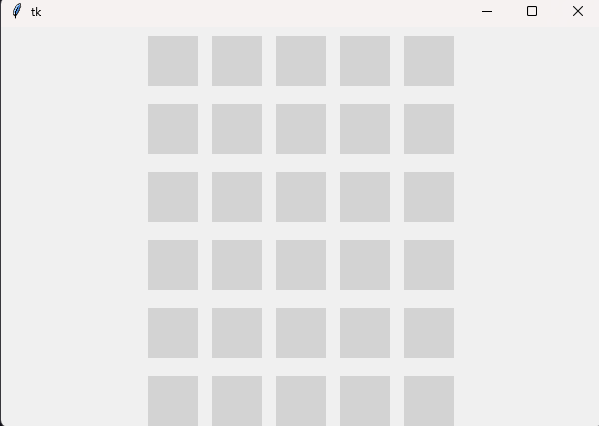
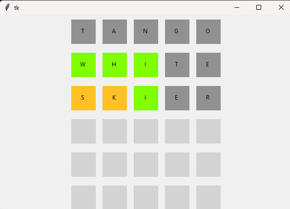

# Wordle v 0.1.0
----

# Description

Wordle is a puzzle game hosted by the New York Times. The goal of the game is to guess a hidden, 5 letter word in under 6 guesses.

Each guess reveals more information about the hidden word. Specifically, when you guess a word, the letters from your guess are marked according to their presence in the hidden word.
## Rules of Wordle
If the player guesses a letter that's present in the word, AND the letter corresponds to the same place on the hidden word, then that letter is marked (G)REEN no matter what.
If the player guesses a letter that's present in the word, but the letter does not correspond to the same place on the hidden word, then that letter is marked (Y)ELLOW.
If the player guesses a letter that's not present in the word, then that letter is marked G(R)AY.

For example, if `secret = heron` and `guess = hello`, then the colors that would be marked are `GGRRY`. 

If a word contains two of the same letter, we check for each individual letter. For example, if `secret=chess` and `guess=scars`, then the letters would be marked as `YYRRG`, because the final 's' is in the correct place, but the initial 's' is not.

Finally, if a guess contains two of the same letter, and that matches only with one on our secret word, the second of the two letters gets marked as gray. For example, `secret=caves` and `guess=chess`, the result would be `YRYRY`.

# Usage
This program should run off the bat without any dependencies required. The tests themselves require the timeout marker. When in doubt, run `pip install -r requirements.txt`. 

Upon entering your environment, run the following commands:
1. `python -m src.server.main`
2. From a separate command line, run `python -m src.frontend.main`. 

You should see something like this: 

Type each row out, and you might see something like this: 

When you are done, you can hit the x button on your tk window and `ctrl+c` on your server CLI window.

